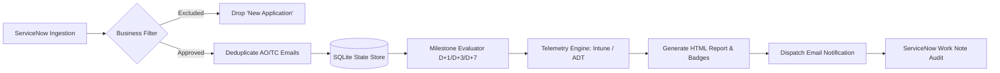

# 🤖 Autonomous Packaging Reporting Agent

[](https://github.com/Dharanisash/Report-automation-AGENT/actions)
[](https://www.python.org/downloads/)
[](https://github.com/langchain-ai/langgraph)
[](LICENSE)

An enterprise-grade, autonomous **LangGraph** AI agent designed to oversee the post-closure software deployment lifecycle for software packaging requests assigned to **`ITSC_WW_RNTBCI_DIR-ICS_Software_Packaging`**.

Unlike rigid procedural scripts, this agent acts as an autonomous reasoning brain: it dynamically queries ServiceNow, evaluates business constraints, manages persistent SQLite lifecycle state, retrieves device telemetry across multiple endpoints (Microsoft Intune with ADT fallback), synthesizes responsive executive HTML reports, and writes bi-directional audit notes back to ServiceNow tickets.

---

## 📌 Table of Contents

- [Core Capabilities & Business Rules](#-core-capabilities--business-rules)
- [System Architecture](#-system-architecture)
- [Repository Structure](#-repository-structure)
- [Quickstart Guide](#-quickstart-guide)
- [Operational Run Guide](#-operational-run-guide)
- [Email Template Preview](#-email-template-preview)
- [Testing & Quality Assurance](#-testing--quality-assurance)
- [Configuration Reference](#-configuration-reference)
- [Documentation Links](#-documentation-links)
- [License](#-license)

---

## 🚀 Core Capabilities & Business Rules

1. **Intelligent Ingestion & Domain Filtering**:
   - Ingests closed-complete packaging tasks for group `ITSC_WW_RNTBCI_DIR-ICS_Software_Packaging`.
   - **Strict Exclusion**: Automatically excludes and drops `New Application Request` tickets.
   - **Approved Types**: Processes `Existing Application`, `Distribution`, `ACENET`, and `Horse Application`.

2. **Recipient Deduplication**:
   - Compares Application Owner (AO / Beneficiary) and Technical Contact (TC / Kit Validator) email addresses.
   - When AO and TC match (e.g. `guillaume.meunier@renault.com`), deduplicates to a single recipient to prevent redundant emails.

3. **Milestone Tracking Engine (D+1, D+3, D+7)**:
   - Tracks deployment progression relative to task closure timestamp ($D_0$).
   - Dynamically calculates due milestones:
     - **D+1**: Initial 24-hour deployment check.
     - **D+3**: Mid-cycle progression assessment.
     - **D+7**: Final deployment audit and ticket completion.

4. **Multi-Source Telemetry & Fallback**:
   - Primary: Queries **Microsoft Intune Graph API** for live targeted, installed, pending, and failed endpoint counts.
   - Fallback: Dynamically re-routes to **ADT (Application Deployment Tracker)** if package telemetry is unavailable in Intune.

5. **Agentic HTML Report Generation**:
   - Formats a responsive, executive HTML email with real-time status badges:
     - 🟢 **Healthy / Compliant** ($\ge 90\%$)
     - 🟡 **Moderate Progress** ($70\% - 89\%$)
     - 🔴 **Action Required** ($< 70\%$)
   - Displays clear KPI metrics and automated action recommendations for technical contacts.

6. **Bi-Directional Audit Trail**:
   - Appends official confirmation work notes back to ServiceNow (`sc_task`).
   - Commits milestone dispatch flags to persistent SQLite storage (`packaging_agent_state.db`).

---

## 🏗 System Architecture

The agent runs as an autonomous **ReAct** (Reasoning + Tool Execution) loop built on **LangGraph**:



Detailed technical documentation and state diagrams can be reviewed in [docs/ARCHITECTURE.md](docs/ARCHITECTURE.md).

---

## 📂 Repository Structure

```text
Report-automation-AGENT/
├── .github/
│   └── workflows/
│       ├── ci.yml                 # Automated test workflow on Python 3.9 - 3.12
│       └── daily-run.yml          # Scheduled daily execution workflow
├── docs/
│   ├── ARCHITECTURE.md            # In-depth architectural design & state machines
│   └── RUN_GUIDE.md               # Operational runbook & scheduling guide
├── src/
│   └── packaging_agent/
│       ├── __init__.py
│       ├── config.py              # Configuration & environment variables
│       ├── db.py                  # SQLite schema & persistence helpers
│       ├── graph.py               # LangGraph StateGraph engine
│       ├── prompts.py             # System prompt & operating procedures
│       ├── templates/
│       │   ├── __init__.py
│       │   └── email_template.py  # Responsive executive HTML email builder
│       └── tools/
│           ├── __init__.py        # Tool exports
│           ├── servicenow.py      # ServiceNow API tools & work notes
│           ├── telemetry.py       # Intune & ADT telemetry retrieval
│           ├── notification.py    # Email dispatch tool (SMTP / Graph / Mock)
│           └── lifecycle.py       # DB task sync & milestone calculation tools
├── tests/
│   ├── __init__.py
│   ├── test_db.py                 # SQLite database & milestone tests
│   ├── test_templates.py          # HTML template & badge rendering tests
│   ├── test_tools.py              # Filtering & deduplication tests
│   └── test_lifecycle.py          # End-to-end autonomous flow tests
├── .env.example                   # Environment configuration template
├── .gitignore
├── Dockerfile                     # Production container image
├── docker-compose.yml             # Container orchestration
├── packaging_agent.py             # Root standalone agent executable
├── pyproject.toml                 # Package definition & metadata
├── requirements.txt               # Pinned dependencies
└── README.md
```

---

## ⚡ Quickstart Guide

### 1. Prerequisites
- Python 3.9 or higher
- OpenAI API Key (`OPENAI_API_KEY`)

### 2. Installation
```bash
# Clone the repository
git clone https://github.com/Dharanisash/Report-automation-AGENT.git
cd Report-automation-AGENT

# Create and activate virtual environment
python3 -m venv venv
source venv/bin/activate  # On Windows: venv\Scripts\activate

# Install dependencies
pip install -r requirements.txt
```

### 3. Configure Environment
```bash
cp .env.example .env
export OPENAI_API_KEY="sk-proj-your-api-key"
```

### 4. Run the Autonomous Agent
```bash
python packaging_agent.py
```

---

## 📖 Operational Run Guide

### Command Line Options
```bash
# View help and options
python packaging_agent.py --help

# Run with a specific OpenAI model
python packaging_agent.py --model gpt-4o

# Run with a custom prompt instruction
python packaging_agent.py --prompt "Check and dispatch pending D+1 packaging reports."
```

### Running with Docker
```bash
# Build Docker image
docker build -t packaging-reporting-agent .

# Run container
docker run --env-file .env -v $(pwd)/packaging_agent_state.db:/app/packaging_agent_state.db packaging-reporting-agent
```

For scheduled cron execution, Windows Task Scheduler instructions, and production deployment scenarios, refer to the full [Operational Run Guide (docs/RUN_GUIDE.md)](docs/RUN_GUIDE.md).

---

## 📧 Email Template Preview

The agent renders executive, modern HTML emails tailored for both mobile and desktop clients:

- **Header**: High-visibility Renault Group packaging header with Application Name and Task ID.
- **Milestone Chip & Status Badge**: Green (Compliant $\ge 90\%$), Amber (Moderate $70-89\%$), Red (Action Required $< 70\%$).
- **Deployment KPI Table**: Targeted, Installed (with %), In-Progress/Pending, and Failed device counts.
- **Next Steps & Guidance**: Dynamic guidance directing the Technical Contact to inspect logs if failures are detected.

---

## 🧪 Testing & Quality Assurance

The test suite validates database state transitions, business filtering rules, deduplication, template rendering, and telemetry fallbacks without external network dependencies:

```bash
# Run tests using Python built-in unittest
python3 -m unittest discover tests -v

# Or run tests using pytest with coverage
pytest --cov=packaging_agent tests/
```

### Test Coverage Highlights:
- ✅ **Task Ingestion & Filtering**: Validates exclusion of `New Application Request` and inclusion of approved types.
- ✅ **Email Deduplication**: Validates single email storage when AO and TC match.
- ✅ **Milestone Engine**: Validates dynamic D+1, D+3, and D+7 delta day triggering.
- ✅ **State Persistence**: Confirms that dispatched milestones are never re-triggered and D+7 marks tasks complete.
- ✅ **HTML Rendering**: Validates color-coded badges and KPI calculations.

---

## ⚙️ Configuration Reference

| Environment Variable | Default | Description |
| :--- | :--- | :--- |
| `OPENAI_API_KEY` | *(Required)* | OpenAI API key for LangGraph reasoning |
| `OPENAI_MODEL` | `gpt-4o` | Model name (`gpt-4o`, `gpt-4o-mini`) |
| `DB_PATH` | `packaging_agent_state.db` | Path to persistent SQLite state database |
| `SNOW_INSTANCE_URL` | `https://mock.service-now.com` | ServiceNow instance URL |
| `SNOW_ASSIGNMENT_GROUP` | `ITSC_WW_RNTBCI_DIR-ICS_Software_Packaging` | Target packaging assignment group |
| `EMAIL_TRANSPORT` | `mock` | Email dispatch mode (`mock`, `smtp`, `graph`) |
| `MOCK_EXTERNAL_SERVICES` | `true` | Set to `false` for live ServiceNow/Intune production APIs |

---

## 📚 Documentation Links

- [System Architecture & State Machine (docs/ARCHITECTURE.md)](docs/ARCHITECTURE.md)
- [Operational Run Guide & Cron Setup (docs/RUN_GUIDE.md)](docs/RUN_GUIDE.md)

---

## 📄 License

This project is licensed under the MIT License - see the [LICENSE](LICENSE) file for details.
