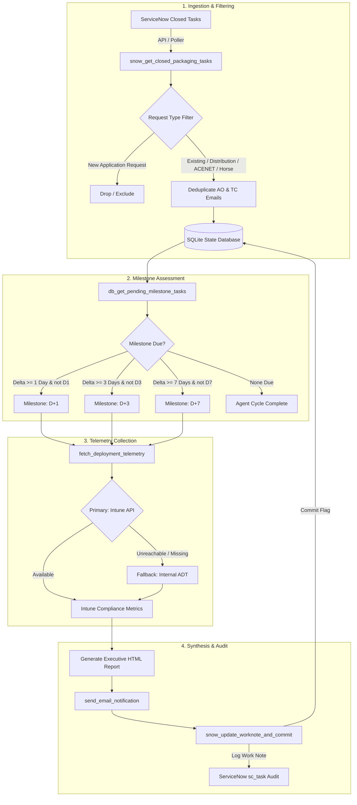
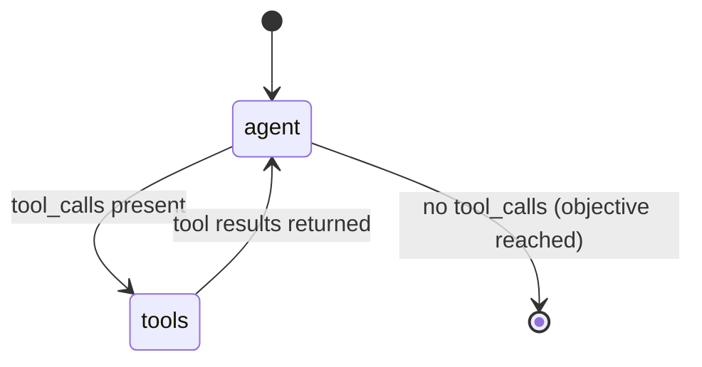

# System Architecture: Autonomous Packaging Reporting Agent

The **Autonomous Packaging Reporting Agent** is an enterprise-grade agentic system built on **LangGraph**, **LangChain**, and **OpenAI GPT-4o**. It autonomously oversees the post-closure deployment lifecycle for enterprise software packaging requests assigned to `ITSC_WW_RNTBCI_DIR-ICS_Software_Packaging`.

---

## 1. High-Level Architecture

The agent operates as a **ReAct (Reason + Act)** loop. Rather than following rigid procedural scripts, the LLM dynamically inspects state, evaluates domain rules, queries external enterprise systems, synthesizes reports, and records audit trails.



---

## 2. LangGraph State Machine

The agent is compiled into a cyclic `StateGraph`:



### State Definition
```python
class AgentState(TypedDict):
    messages: Annotated[List[BaseMessage], "Conversation history and agent scratchpad"]
```

The agent iterates between the reasoning node (`agent`) and the tool execution node (`ToolNode`) until all pending milestones for the current cycle are processed and committed.

---

## 3. Business Rule Matrix

| Rule | Requirement | Implementation |
| :--- | :--- | :--- |
| **Assignment Group** | Only inspect `ITSC_WW_RNTBCI_DIR-ICS_Software_Packaging` | Query filter `assignment_group.name=ITSC_WW_RNTBCI_DIR-ICS_Software_Packaging` |
| **Task State** | Only closed-complete packaging tasks | State `3` (Closed Complete) |
| **Strict Exclusion** | Exclude `New Application Request` tickets | Agent filter ignores these requests; no database record or report sent |
| **Valid Request Types** | `Existing Application`, `Distribution`, `ACENET`, `Horse Application` | Ingested and tracked |
| **Recipient Deduplication** | AO (Beneficiary) and TC (Kit Validator) emails | If `ao_email == tc_email`, deduplicate to 1 recipient |
| **Milestone Windows** | D+1, D+3, D+7 relative to ticket closure | Calculated using `(current_date - closed_date).days` |
| **Telemetry Fallback** | Intune Graph API with fallback to ADT | If Intune cannot find package or times out, query internal ADT |
| **Audit Requirement** | Bi-directional work notes back to ServiceNow | Log formatted work note and set milestone flags (`d1_dispatched`, `d3_dispatched`, `d7_dispatched`) |

---

## 4. SQLite State Store Schema

The local SQLite database (`packaging_agent_state.db`) provides idempotent lifecycle tracking across daily runs:

```sql
CREATE TABLE IF NOT EXISTS tracked_tasks (
    task_id TEXT PRIMARY KEY,               -- ServiceNow Catalog Task (e.g. SCTASK2444402)
    ritm_id TEXT NOT NULL,                  -- ServiceNow Requested Item (e.g. RITM2566659)
    app_name TEXT NOT NULL,                 -- Application Package Name
    req_type TEXT NOT NULL,                 -- Request Type
    closed_date TEXT NOT NULL,              -- Closure ISO Timestamp
    recipients TEXT NOT NULL,               -- Semicolon-delimited deduplicated email addresses
    d1_dispatched INTEGER DEFAULT 0,        -- Flag for D+1 report
    d3_dispatched INTEGER DEFAULT 0,        -- Flag for D+3 report
    d7_dispatched INTEGER DEFAULT 0,        -- Flag for D+7 report
    is_completed INTEGER DEFAULT 0,         -- Set to 1 upon D+7 dispatch
    created_at TIMESTAMP DEFAULT CURRENT_TIMESTAMP
);
```

---

## 5. Compliance Status & Email Badging

The agent synthesizes an executive-level, responsive HTML email based on live deployment metrics:

$$\text{Compliance } \% = \left(\frac{\text{Installed Devices}}{\text{Targeted Devices}}\right) \times 100$$

| Compliance Range | Status Badge | Color Code | Action Required |
| :--- | :--- | :--- | :--- |
| **$\ge 90.0\%$** | `HEALTHY / COMPLIANT` | `#10B981` (Green) | None; deployment on track. |
| **$70.0\% - 89.9\%$** | `MODERATE PROGRESS` | `#F59E0B` (Amber) | Advisory note to Technical Contact. |
| **$< 70.0\%$** | `ACTION REQUIRED` | `#EF4444` (Red) | High-visibility warning to TC with log inspection guidance. |
